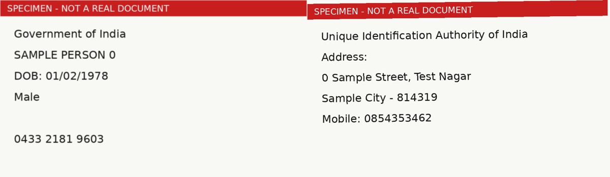

# KYC Document OCR

Read Aadhaar, PAN, voter ID and driving licence images, check they are what they claim to be, pull out the fields, and decide which records can go straight to the bank.

Built in 2020 to 2023 for FASTag and lending onboarding at a logistics tech company.

> **No real identity documents or personal data are in this repo.** Every image is a generated specimen with a red "SPECIMEN - NOT A REAL DOCUMENT" banner. Aadhaar-style numbers start with 0 or 1, which UIDAI never issues. Phone numbers start with 0. Names are "SAMPLE PERSON n".



## The problem

To issue a FASTag through a partner bank, every truck owner needs KYC: usually Aadhaar and PAN. Owners upload photos from the field. Many uploads were the wrong document, the wrong side, too blurry, or missing a field. The bank rejected those records, and every rejection meant another call to the owner.

Checking by hand did not scale across tens of thousands of records. The goal was to automate the easy cases and send people only the hard ones.

## How it works

1. **OCR** each image. The original used Google Vision. The demo uses Tesseract so it runs for free on any laptop.
2. **Check the document type** with keyword rules. "Government" points to Aadhaar front. "Unique Identification" points to Aadhaar back. "Election Commission" points to voter ID. "Driving Licence" points to a DL.
3. **Pull out fields** with regex: Aadhaar number, date of birth and gender from the front; pincode and phone from the back; PAN number and date of birth from the PAN card.
4. **Stitch front and back** into one image, so a vendor that charges per image reads both sides in one call.
5. **Check toll cash slips** for the words that a real receipt carries (Vehicle, Highway, Journey). This weeded out random photos uploaded as dispute proof.
6. **Route** each owner: complete and valid records go to the bank; the rest go to manual review.

## Results on specimen documents

`python demo.py` renders 105 specimen images with slight tilt and blur, OCRs them, and scores everything against the known answers.

- Document type correct: 100% across all seven kinds, including PAN, cash slips and junk photos, which correctly match nothing.
- Aadhaar number, DOB, gender, pincode and phone: 100%.
- PAN number with the original rule: **40%**. With a shape-based regex: **100%**.
- Routing: 87% straight to the bank. The rest are the specimens planted with a bad Aadhaar checksum, which get caught and sent to review.

## What the numbers say

The PAN drop is the lesson. The original rule took "the line after Permanent Account Number." That worked on Google Vision, which returns tight lines. Tesseract puts a blank line between blocks, so the rule read an empty string 6 times out of 10. Same image, same rule, different OCR engine, and the result falls apart. Rules that depend on layout break quietly when you change vendors. Rules that depend on the shape of the value itself (five letters, four digits, one letter) do not.

Two checks were missing from the original, and both are added here. The Aadhaar number has a built-in check digit (Verhoeff). Testing it catches OCR misreads and typos before the bank does. And only the last four digits are kept for display (`XXXX XXXX 1234`). Storing full Aadhaar numbers creates a liability nobody needs, and UIDAI rules require masking.

## Run it

Tesseract has to be installed first (`brew install tesseract` on Mac, `apt install tesseract-ocr` on Ubuntu).

```bash
pip install -r requirements.txt
python demo.py
pytest
```

To use Google Vision like the original: `pip install google-cloud-vision`, set `GOOGLE_APPLICATION_CREDENTIALS`, then `OCR_ENGINE=google python demo.py`.

## Repo layout

```
kyc_ocr/
  parsers.py    field extraction and doc-type rules (ported), validation and routing
  ocr.py        Google Vision and Tesseract backends, front/back stitcher
  specimen.py   fake, watermarked specimen document generator
samples/        three specimen images for this README
notebooks/original/  the real notebooks, cleaned (see the README inside)
```

## What changed from the original code

- Parsers take OCR text instead of calling Google Vision themselves, so any engine can feed them.
- `front_pan_card` crashed when no label line was found and only looked for the date of birth on the last line. Both fixed.
- The doc-type check returned an unbound variable when nothing matched. It now returns an empty string.
- Added: `pan_from_text`, Verhoeff checksum, PAN format check, Aadhaar masking.
- The image stitcher uses Pillow instead of OpenCV. Same output.

## Data and privacy

No real documents, numbers, names or addresses are in this repo, in the code, or in the notebooks. The original notebooks had every output removed (that is where real OCR results lived). Internal document-store and OCR service addresses, S3 bucket names, database credentials and sheet links were replaced with placeholders. Input CSV file names are still referenced in the notebooks, but none of those files are included.
